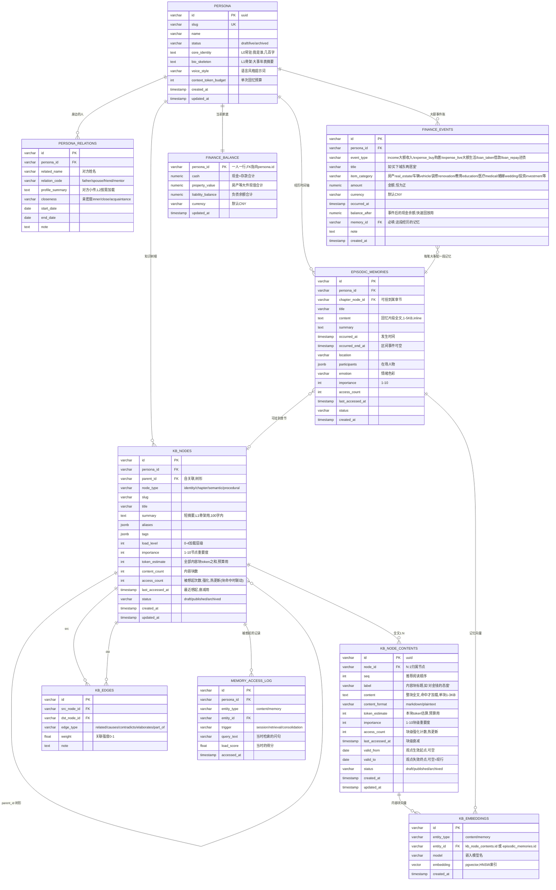

# 「模拟人类」知识库 —— 分层记忆 ER 设计

> 目标不是描述"一个人的事实数据"，而是构建一个 **Agent 可渐进式加载的知识库**：
> Agent 像人一样"回忆"——先想起我是谁（身份），再想起大概经历过什么（骨架），
> 需要时才调取细节（情节/语义），并且记忆有重要度、有衰减、有强化。
> 目标库：`virtual_human`（已装 `vector 0.8.7`，可直接做检索式加载）。
>
> 检索粒度决策：**不做 chunk 切块，渐进式加载内容块全文**。
> 一个节点（kb_nodes）下挂 **多个内容块（kb_node_contents，1:N）**，
> 内容块是加载的最小完整单元（单块 1-3KB），命中即整块给 Agent。
>
> 版本化决策：**暂不做 kb_node_revisions 修订史**。
> 观点演变由内容块的 `valid_from/valid_to` 承载；如日后需要审计/回滚，再加快照表，schema 不用动。
>
> 财务域决策：**只做"大额事件账"**，不做复式记账。
> 模拟粒度 = 买过什么、花多少钱、剩多少钱。两笔流水 + 一个余额，够用。
> 日常小额开销不入账（记忆里可以"记得"），只记大额：买房、买车、装修、大病、彩礼……

## 认知模型 → 存储映射

借鉴认知科学的记忆分类 + Generative Agents 的检索模型：

| 认知概念 | 加载层级 | 存储 | Agent 行为 |
| --- | --- | --- | --- |
| 核心身份（我是谁） | L0 常驻 | `persona.core_identity` + `kb_nodes(type=identity)` | 每次会话必进 system prompt |
| 人生骨架（大事年表） | L1 会话启动加载 | `kb_nodes` 的 summary（轻表） | 开场时全部标题+摘要进上下文 |
| 语义记忆（观念/知识/价值观） | L2 按需检索 | `kb_node_contents`（重表，内容块） | 向量+关键词命中才加载整块全文 |
| 情景记忆（具体事件片段） | L3 按需检索 | `episodic_memories` | 按 时间×相关度×重要度 检索 |
| 程序性记忆（习惯/口癖/技能） | L3 按需检索 | `kb_nodes(type=procedural)` | 对话风格场景才加载 |
| 财务大事（买过什么/剩多少） | L2 按需查询 | `finance_events` + `finance_balance` | 精确查询走账；感受走互链记忆 |
| 冷记忆（访问史） | L4 冷备 | `memory_access_log` | 仅一致性核查/巩固任务用 |

**渐进式加载公式**（Agent 决定"想起什么"）：

```
load_score = w1·向量相似度 + w2·importance + w3·recency(衰减) + w4·access_count(强化)
```

在 token 预算内按 `load_score` 从上往下装，装满即停——这就是"渐进式"。

## 冷热分离 + 一对多：kb_nodes 拆表

**`content` 大文本从 `kb_nodes` 拆出**，且一个节点可挂**多个内容块**：

| 表 | 温度 | 内容 | 为什么 |
| --- | --- | --- | --- |
| `kb_nodes` | 热 | 元数据 + summary + token_estimate（汇总） | L1 骨架加载是**全表批量扫**（几十上百节点），绝不能带大文本 |
| `kb_node_contents` | 冷 | content 全文，**1:N** | 只在 L2 命中时 join；TOAST 解压成本只花在真正需要的时候 |

为什么内容块是 1:N 而不是 1:1：

1. **一个主题多个侧面**：如"价值观"节点下分"对家庭""对金钱""对事业"多块，各块独立加载，不必一次拖全主题。
2. **观点随时间演变**：同一主题不同人生阶段的表述可以并存多块（配合块内 `valid_from/valid_to` 表达先后），而不是覆盖式修订。
3. **渐进装载的合适粒度**：加载预算按块计算，装 3 块小的好过装 1 块大的；块是"完整语义"的最低单位，比 chunk 切块干净。
4. **独立打分**：块有自己的 importance / access_count / 向量，检索命中粒度=块。

拆表的实际收益：

1. **TOAST 隔离**：大 text 在 PG 里走 TOAST 压缩外置存储。混在热表里，批量读 summary 时一旦列被扫到就触发解压；拆开后 `SELECT id,title,summary FROM kb_nodes` 物理上碰不到 content。
2. **热更新不打扰冷数据**：`access_count`/`last_accessed_at` 每次检索都会 UPDATE，窄行更新的 MVCC 开销和索引膨胀远小于带着大 blob 的宽行。
3. **防 `SELECT *` 事故**：ORM 默认全列加载，一处疏忽就把几百 KB 拖进上下文。拆表后"忘了排除 content"这种错误在 schema 层面不可能发生。

> `episodic_memories.content` 暂不拆：单条记忆通常 1-5KB，inline 合理。若日后出现长回忆（如日记全文），同款拆法套用即可。

> **为什么不切块（chunk）**：切块的收益在大文档（几十 KB 以上）检索时才明显。本库约束"一个知识点一个节点、一个侧面一个内容块"，单块通常 1-3KB（几百到一千 token），向量按块召回 + 整块加载，链路简单且无切块/重建的一致性维护。若某块膨胀超过阈值（如 5KB），应在写库侧拆成兄弟块或子节点，而不是切块。

## 财务域：大额事件账（简化模型）

**只回答三个问题：买过什么？花多少钱？剩多少钱？**

| 表 | 作用 |
| --- | --- |
| `finance_events` | 大额收支事件：买房 187 万、买车 22 万、买房收入彩礼 30 万、年终奖 15 万……每笔一行，带事件后余额 |
| `finance_balance` | 当前家底：一张表一个人一行，现金/存款/房产市值/负债余额 + 计算列净资产 |

设计取舍：

1. **不建账户体系**（原 finance_accounts）：一个人就一个"钱包"概念，现金+存款合并看，分账户是真实记账 App 的事。
2. **不建流水表**（原 finance_transactions）：日常柴米油盐不模拟。只记"大额事件"——事件本身就是叙事素材，每笔自动配一条情景记忆。
3. **不建周期规则**（原 finance_recurring_rules）：工资月供不逐月模拟，收支的"常态"由 Agent 在对话中即兴生成（符合人设即可），账上只落大额。
4. **不建月度快照**（原 finance_snapshots）："剩下多少钱"直接读 `finance_balance`，历史余额从 `finance_events.balance_after` 回放。
5. **事件必挂记忆**：`finance_events.memory_id` 直接指向 `episodic_memories`，每笔大额支出都伴随一段人生叙事——买的不只是房，是"终于有了自己的家"。

余额守恒（唯一约束）：

```
finance_balance.cash
  = 初始现金 + Σ(income) - Σ(expense_buy) - Σ(expense_live) - Σ(loan_repay)
finance_balance.liability_balance
  = Σ(loan_taken) - Σ(loan_repay)
finance_balance.net_worth = cash + property_value - liability_balance   (查询时算,不落盘)
```

## ER 图



## 渐进式加载协议（Agent 侧）

```
会话开始
 ├─ L0: 读 persona.core_identity + voice_style        → 必进 system prompt
 ├─ L1: SELECT title,summary,token_estimate FROM kb_nodes（热表,无content）→ 人生骨架
 └─ 每轮对话按需:
     ├─ 用户输入 → embedding → kb_embeddings(content级+memory级) 近邻召回
     ├─ 候选 = 命中内容块(load_level≥2的节点下) ∪ episodic_memories
     ├─ 按 load_score 排序,对照块级 token_estimate 做预算,装满即停
     ├─ L2: 命中块 → 读整块 content；同节点兄弟块只带 label 备选
     ├─ 需要整体脉络时 → 读节点 summary,或按 seq 顺序补齐兄弟块
     └─ 命中写 memory_access_log,块与所在节点的 access_count/last_accessed_at 联动更新
财务问题专用通路(不走向量,走账)
 ├─ "买过什么"        → SELECT * FROM finance_events ORDER BY occurred_at
 ├─ "买房花了多少"    → finance_events(item_category=real_estate)
 ├─ "现在剩多少钱"    → finance_balance 一行
 ├─ "当时为什么买房"  → finance_events.memory_id → episodic_memories 读叙事
 └─ 日常小额(早饭/打车) → 不查账,Agent 按人设即兴回答
两级内容粒度
 ├─ summary       : ~100 token, L1 免费, 节点级
 └─ content 整块  : 1-3KB, 命中才给, 块级
记忆巩固(离线任务)
 ├─ 高频被想起的 memory → consolidation 升格为新节点的内容块
 ├─ 内容块膨胀(>5KB) → 写库侧拆成兄弟块或子节点
 └─ 观点演变 → 旧块 valid_to 封口,新块 valid_from 生效,不覆盖旧块
```

## 表清单

| 表 | 温度 | 作用 |
| --- | --- | --- |
| `persona` | 热 | 模拟对象根档案 + 常驻身份 |
| `kb_nodes` | 热 | 知识树元数据：身份/章节/语义/程序性，summary + 统计，**无大文本** |
| `kb_node_contents` | 冷 | 节点内容块，**1:N**，检索单元=块，命中才 join |
| `kb_edges` | 温 | 知识点之间的语义关联，支持联想加载 |
| `episodic_memories` | 温 | 情景记忆时间轴（content 1-5KB inline） |
| `persona_relations` | 温 | 身边的人（轻量，不强制建 persona） |
| `kb_embeddings` | 派生 | pgvector 统一向量索引（content+memory），HNSW |
| `memory_access_log` | 调度 | "何时想起过什么"，驱动衰减与强化 |
| `finance_events` | 账 | 大额事件账：买过什么/花多少/借过还过，每笔必挂记忆 |
| `finance_balance` | 账 | 当前家底：现金/大件现值/负债余额，一人一行 |

## 关键设计点

1. **冷热分离 + 1:N 内容块**：热表（nodes 元数据）撑 L0/L1 的批量轻读；冷表（contents）按块 join；块是检索单元也是加载单元。
2. **打分在块级**：块有自己的 importance / access_count / last_accessed_at / 向量；节点的 access_count 是联动汇总，用于骨架层的"哪些主题常被想起"。
3. **token_estimate 两级都有**：节点级是汇总（预算决策），块级是精确值（装载执行）。
4. **valid_from/valid_to 表达观点演变**：旧观点封口不删除，Agent 可按时间取"当时 believed 什么"，符合人格一致性需求；这也是不做修订史表的理由——演变本身就是数据，不是修订。
5. **衰减与强化**：`last_accessed_at` 越久远分数越低（遗忘），`access_count` 越高分越高（熟练）。
6. **kb_edges 解决"联想"**：加载节点 A 时顺带预取 weight 高的关联节点 summary。
7. **暂无修订史表**：内容块的 status=archived + valid_to 已提供"过去版本还在库里"的能力；真需要审计快照时再补 `kb_node_revisions`，不影响现有表。
8. **财务只记大事**：大额事件进账（买房/买车/彩礼/大病），日常开销不入账、由 Agent 即兴生成；账是"人生里程碑"，不是记账软件。
9. **每笔大事必配记忆**：`finance_events.memory_id` NOT NULL——数字与叙事同时落库，"花 187 万"和"终于有了自己的家"是同一件事的两面。
10. **余额双通道**：现状读 `finance_balance`（一行），历史回放用 `finance_events.balance_after` 逐笔推演；`net_worth` 查询时计算不落盘，避免不一致。
11. **写入口径唯一**：所有财务变更只通过"追加 finance_event + 重算 balance"完成，不允许直接改余额——保证账实相符。

## 待确认

1. 嵌入模型用哪个？（决定 `vector` 维度：OpenAI 1536 / bge-m3 1024 / qwen 1024…）
2. `persona_relations` 要不要升级成完整 `persona`（即"别人"也是可对话的 agent）？
3. 是否需要"遗忘"硬机制：超过 N 天未被访问且 importance 低的记忆自动降级为 archived？
