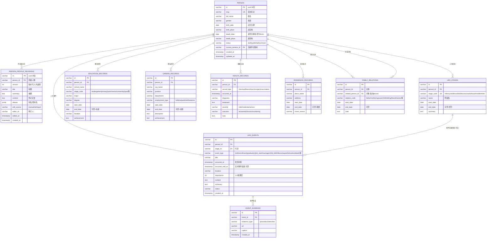

# 「人的一生」数据模型 —— ER 设计

> 参考 `wiki_page_revisions` 的设计思想（varchar(36) 主键、version 版本化、status 生命周期、jsonb aliases、edit_source/editor_id 审计字段），
> 以 `person` 为中心派生出"一生"模型。目标库：`virtual_human`（owner: consumer，已装 vector/pg_trgm/uuid-ossp）。

## 设计思路

1. **person 是根实体**：一个人 = 一条主档记录（身份 + 生卒 + 当前状态）。
2. **版本化**：`wiki_page_revisions` 的"页面修订"思想落成 `person_profile_revisions`——人物传记/档案的每一次修订都留版本，主表只存当前指针。
3. **一生 = 时间轴**：横向切分为 `life_stages`（阶段），纵向在阶段上挂 `life_events`（点事件/区间事件）。
4. **领域事实表**：教育、职业、健康、居住、亲缘关系各自成表，都带 `start/end` 双时态字段，事件表可只挂时间点。
5. **佐证**：`event_evidence` 给事件挂照片/文件/链接（对应 wiki 体系里 evidence 的思路）。

## ER 图

## 表清单

| 表 | 说明 | 关键约束/索引 |
| --- | --- | --- |
| `person` | 人物主档 | UK(`slug`) |
| `person_profile_revisions` | 传记修订版本 | UK(`person_id`,`version`)，IDX(`person_id`) |
| `life_stages` | 人生阶段 | UK(`person_id`,`stage_code`) |
| `life_events` | 人生事件（点/区间） | IDX(`person_id`,`occurred_at`)，IDX(`stage_id`) |
| `event_evidence` | 事件佐证附件 | IDX(`event_id`) |
| `education_records` | 教育经历 | IDX(`person_id`) |
| `career_records` | 职业经历 | IDX(`person_id`) |
| `health_records` | 健康记录 | IDX(`person_id`) |
| `residence_records` | 居住变迁 | IDX(`person_id`) |
| `family_relations` | 亲缘/社会关系（自关联） | UK(`person_id`,`related_person_id`,`relation_code`) |

## 与 wiki_page_revisions 的对应

| wiki_page_revisions | 本模型 |
| --- | --- |
| `kb_id` + `page_id` | 收敛为 `person_id`（一个人即一个"页面"） |
| `slug` | 移到 `person.slug`（页面标识属于主档） |
| `version` | `person_profile_revisions.version`，人内递增 |
| `page_type` / `status` | 主表 `person.status` 承载生命周期 |
| `content` / `summary` / `aliases` | 原样保留在修订表 |
| `edit_source` / `editor_id` / `edited_at` | 原样保留（manual/ai/import 可区分 AI 代笔） |

## 设计要点

- **双时态**：阶段/教育/职业/居住/关系用 `start_date + end_date`（NULL=延续至今）；`life_events` 用 `occurred_at`，区间事件补 `occurred_end_at`。
- **时间精度**：统一用 `timestamp without time zone`，与参考表一致；出生/逝世用 `date`。
- **软删除**：暂不做，靠 `status=archived` 表达。
- **owner**：本库统一 `OWNER TO consumer`（参考 DDL 里的 `tianshu` 在本容器不存在）。

## 待确认

1. 关系表是否需要指向"不在库中的人"？现在 `related_person_id` 必须是库内 `person`；如果只想存"父亲：张某某"这类文字，可加 `related_name` 兜底。
2. 事件本身是否也要版本化（每个事件留修订史），还是只有传记总纲版本化？
3. 是否需要 `event_evidence` 这类附件佐证表？
