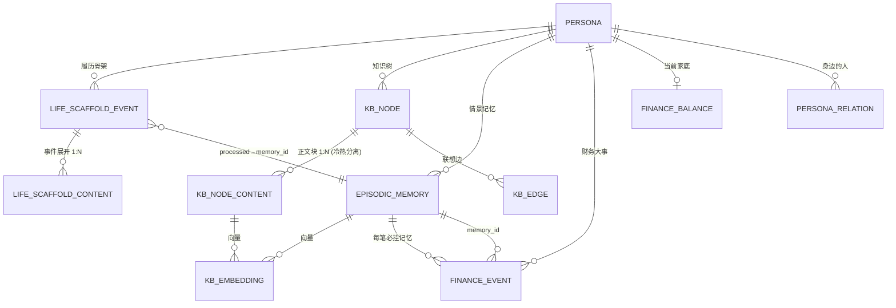

# 整体架构

> 「模拟人类」虚拟人知识库:从人生履历骨架到可对话、可持续演化的虚拟人。

---

## 1. 系统定位

本系统解决的核心问题:**把一份结构化的人生履历(骨架事件),铸造成一个有记忆、有性格、有账本的虚拟人,并支撑低成本的高质量拟人对话**。

三条业务主线:

1. **铸造(生成侧)**:骨架事件导入 → LLM 渐进消化 → 情景记忆 + 知识节点 + 财务大事记。
2. **管理(治理侧)**:骨架与知识库的增删改查、质检、修复、人工修订。
3. **模拟(消费侧)**:PersonaAgent 按 token 预算渐进加载记忆,流式对话。

---

## 2. 分层架构图

```
┌─────────────────────────────────────────────────────────────────────┐
│  接入层                                                              │
│  vh_cli (uv run vh-ingest / vh-show / vh-chat)                      │
│  vh_api (FastAPI: REST + SSE)          web (Vue3: 9 视图)           │
└───────────────┬─────────────────────────────────────────────────────┘
                │
┌───────────────▼─────────────────────────────────────────────────────┐
│  应用服务层 (vh_api)                                                  │
│  scaffold_service  骨架事件存储/策略写入/批次取数/敏感标记              │
│  chat_service      会话注册表 + SSE 编排                              │
│  job_service       后台任务 (内存态 running → jobs 表终态)            │
│  checkpointer      LangGraph/对话 的 PG checkpoint                   │
└───────────────┬─────────────────────────────────────────────────────┘
                │
┌───────────────▼─────────────────────────────────────────────────────┐
│  领域层                                                              │
│  vh_simulate  PersonaAgent: system 组装 / 渐进回忆工具 / 历史压缩      │
│  vh_generate  录入(tool-calling) / 骨架渐进铸造 / 质检 / 编辑 / 嵌入  │
│               scaffold_gen   五步铸造流水线                           │
│               scaffold_graph LangGraph 状态机 (可断点续跑)            │
│               progressive    RangeFeed 渐进读取 + 折叠 + 拦截降级      │
└───────────────┬─────────────────────────────────────────────────────┘
                │
┌───────────────▼─────────────────────────────────────────────────────┐
│  知识库层 (virtual_human, 零 LLM 依赖)                                │
│  models     ORM (唯一 schema 事实来源)                                │
│  kb         retrieval (同步) / async_api (异步): L0/L1/L2 渐进加载    │
│  scaffold   life_scaffold_events / contents                          │
│  jobs/qc    任务表 / 质检问题表                                        │
│  db         同步/异步 session 工厂, run_async (Windows loop)          │
│  storage    RustFS (S3) 文档读写                                      │
└───────────────┬─────────────────────────────────────────────────────┘
                │
┌───────────────▼─────────────────────────────────────────────────────┐
│  基础设施                                                            │
│  PostgreSQL + pgvector (HNSW)      LLM (OpenAI 兼容端点)             │
│  RustFS 对象存储 (agent 文档)       Alembic 迁移                       │
└─────────────────────────────────────────────────────────────────────┘
```

**依赖铁律(单向,自上而下)**:

```
vh_api → vh_cli/vh_simulate → vh_generate → virtual_human
```

唯一例外是**嵌入注入**:`vh_generate` 启动时调 `kb.retrieval.register_embedder()` 注册查询向量化函数,知识库层通过函数指针反向调用——代码上仍保持 `virtual_human` 不 import 任何上层包。

---

## 3. 数据架构

### 3.1 核心实体关系



### 3.2 L0/L1/L2 分层与冷热分离

| 层 | 内容 | 存储 | 装载时机 |
| --- | --- | --- | --- |
| **L0** | `persona.core_identity`(身份自述)+ voice_style | persona 表 | 每次会话必进 system prompt |
| **L1** | 全部 kb_nodes 的 `title + summary`(人生骨架索引,`<slug>` 标签) | kb_nodes 热表 | 会话常驻 / 工具浏览 |
| **L2** | kb_node_contents 正文块全文(单块 1-3KB) | contents 冷表 | 命中才 join(检索/工具 level=2) |
| **账本** | finance_events + finance_balance | 关系表 | 精确数字唯一来源,不走向量 |

- `kb_nodes` 无正文大字段,L1 扫描只碰热表;`disclosure_level(0-9)` 控制 agent 简介披露;`importance(1-10)` 参与装载打分。
- `kb_embeddings` 统一索引 content 与 memory 两类实体(`entity_type + entity_id + model` 唯一),HNSW cosine。
- `memory_access_log` 记录每次「想起」,驱动新近度衰减与访问强化(遗忘曲线的数据基础)。

### 3.3 关键状态字段

| 字段 | 语义 |
| --- | --- |
| `life_scaffold_events.processed` | 该事件是否已消化为记忆(批次推进的游标) |
| `life_scaffold_events.sensitive` | 曾被审核拦截,黄色标记,不再送 LLM |
| `life_scaffold_events.memory_id` | 消化产物回链,删除事件时级联删记忆 |
| `jobs.status` | running / done / error(运行态在内存,终态落表) |
| `qc_issues.status` | open / resolved / dismissed |

---

## 4. 关键流程

### 4.1 铸造主线(骨架 → 虚拟人)

```
外部 JSON 事件 (≤2000 条)
        │  POST /api/personas/scaffold (建 persona + save_events)
        ▼
life_scaffold_events (processed=false, 按 start_year 排序)
        │  POST /api/personas/{pid}/scaffold/generate → 后台 job
        ▼
┌─ LangGraph 状态机 (scaffold_graph, thread_id=scaffold-{pid}, PG checkpoint) ─┐
│                                                                              │
│  ensure_skeleton      为空时: RangeFeed 渐进读履历 → 增量归纳骨架              │
│        ↓                                                                     │
│  ensure_personality   为空时: 渐进读履历 → 归纳性格导向提示词                    │
│        ↓                                                                     │
│  fetch_batch ──(有 pending)──→ generate_memories ─┐                           │
│        │                                          │ (每批 5 条)             │
│        │←─────────────────────────────────────────┘                           │
│        ↓ (无 pending)                                                         │
│  expand_events        每条事件 → summary + 第三人称正文 (1:N contents)         │
│        ↓                                                                     │
│  finalize     按年份段组批 → 知识节点(kb_nodes, ≤12 个, tags.source=scaffold)  │
│               + 财务大事(finance_events, 编号候选防张冠李戴)                    │
│               → bio_skeleton = 知识节点标题索引(<slug> 引导探索)                │
└──────────────────────────────────────────────────────────────────────────────┘
```

健壮性内建在每一步:
- 每条事件消化成功即 `mark_processed` + 写回 `memory_id`——**断点续跑天然幂等**;
- 审核拦截三级降面:整批 → 逐条 → 本地模板兜底(标记 sensitive,黄色显示);
- LLM 漏调工具的事件由「未覆盖检测」模板兜底,保证进度不卡死;
- 财务金额只能引用履历候选编号,金额/年份强制与清单一致。

### 4.2 骨架增删改(增量演化)

```
POST /api/personas/{pid}/scaffold/insert
     strategy=insert | replace(删除入参年份范围旧事件) | merge(同年份+同类型合并 payload)
     ↓ 同事务: drop_event 级联删记忆/展开; merge 重置 processed 并删旧产物
     ↓ generate=true 时后台 job: 新增事件逐批生成 → finalize 重建知识节点与财务
```

### 4.3 模拟对话(消费侧)

```
用户问题
   │  PersonaAgent (brief 模式: system = L0 身份 + L1 骨架索引 + 账本)
   ▼
每轮 aretrieve_context (向量/词面召回 → load_score 打分 → 预算装载)
   │                          │
   │ tool-call 渐进回忆        │ trim_messages 硬裁剪
   │ LoadTree(L0/L1) ─┐       │ + 超预算×2.5 时 LLM 摘要压缩历史
   │ LoadContent(L1/L2)│       ▼
   │ RecallMemory(L1/L2)│   LLM astream → SSE 打字机 → 前端
   │ RetrieveContext ───┘
   ▼
访问记录回写 (access_count/last_accessed_at/memory_access_log)
```

账本数字的唯一权威是 `[财务大事记]`,prompt 明确约束 agent 不得编造。

---

## 5. 部署形态

```
┌─ 浏览器 ─────────────────────┐
│  Vue3 SPA (vite build → dist) │
└──────────────┬───────────────┘
               │ REST / SSE
┌──────────────▼───────────────┐     ┌──────────────────────┐
│ uv run vh-api --port 8300     │────▶│ LLM (OpenAI 兼容)     │
│  (单进程, lifespan 自检+清理)  │     └──────────────────────┘
└──────┬───────────────┬───────┘     ┌──────────────────────┐
       │               └────────────▶│ RustFS :9000/:9001    │
       ▼                             └──────────────────────┘
┌─────────────────────┐
│ PostgreSQL+pgvector │  (alembic 管理 schema; checkpoint 表由 saver.setup() 幂等建)
└─────────────────────┘
```

- 单进程 asyncio 承载全部请求与后台任务;`job_service.spawn_job` 登记任务,shutdown 时统一取消并 dispose 连接池。
- 前端 dev 模式 vite 代理,生产直接托管 `web/dist`。

---

## 6. 架构特性与保证

| 特性 | 实现机制 |
| --- | --- |
| **断点续跑** | 铸造状态机配 PG checkpointer(thread_id=scaffold-{pid});processed 游标天然幂等 |
| **长履历不炸上下文** | RangeFeed 按年份分页 + 旧批折叠 + 压缩中间件(见核心技术实现 §3) |
| **审核容错** | 拦截识别 → 三级降面 → sensitive 隔离,不 fail-fast |
| **无 Key 可跑** | LLM 走 mock、嵌入降级词面相似度、RustFS 未配置不挂文档工具 |
| **多模型可换** | `OPENAI_BASE_URL` + `VH_LLM_MODEL`/`VH_EMBED_MODEL` 环境变量 |
| **对话记忆演化** | 访问日志 → recency 衰减(30 天半衰期)+ access 强化(20 次封顶) |
| **Windows 可用** | SelectorEventLoop policy 统一切换;CLI 强制 UTF-8 输出 |
| **schema 演进** | ORM 唯一事实来源 → alembic autogenerate → 同步 sql/schema.sql |

---

## 7. 目录索引

```
src/virtual_human/     models.py · kb/(retrieval, async_api) · scaffold.py · jobs.py · qc.py
                       db.py · config.py · storage.py · chat.py · healthcheck.py
src/vh_generate/       generate/(agent, seeder_tools, scaffold_gen, scaffold_graph,
                       progressive, compression, checker, editor, embeddings, tools)
src/vh_simulate/       simulate.py (PersonaAgent) · docs_middleware.py
src/vh_api/            main.py · scaffold_service.py · job_service.py · chat_service.py
                       checkpointer.py · routers/ · application/ · infra/(sse, sessions)
src/vh_cli/            main.py · io_setup.py
web/src/views/         Personas / Forge / Timeline / Inspect(Tree,Check,Edit) / Simulate / Docs / Jobs
migrations/ + sql/     alembic 版本与全新建库 DDL
docs/                  kb_er · life_er · api · 技术选型 · 核心技术实现 · 整体架构
```
