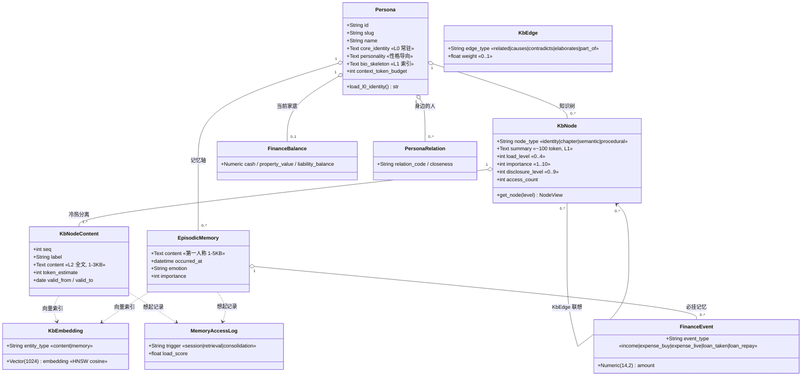
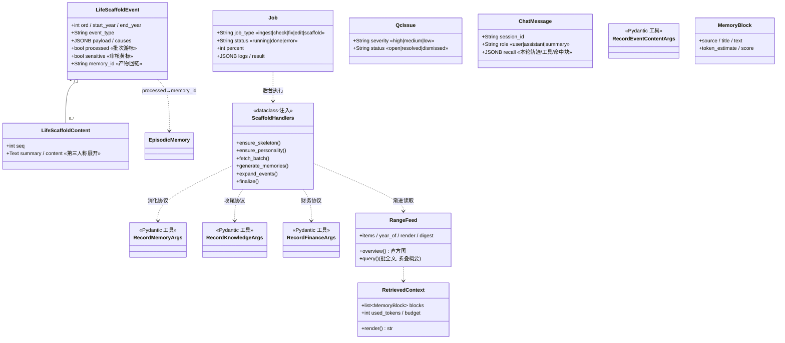
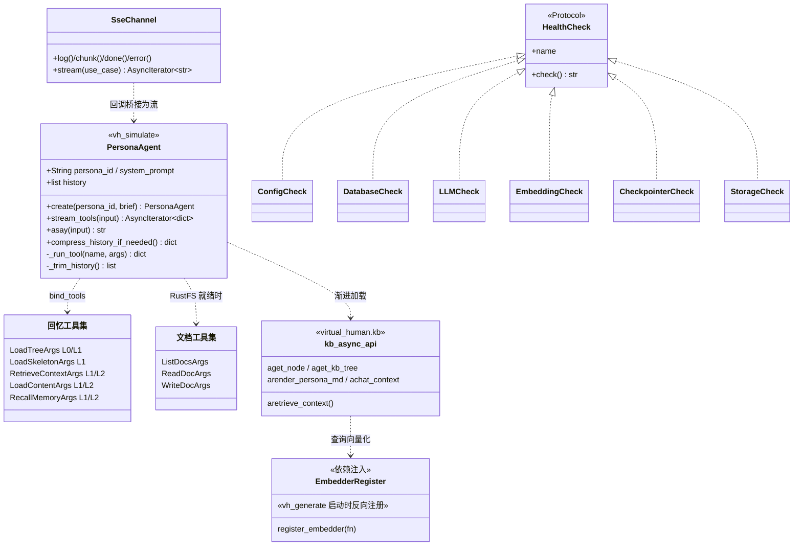
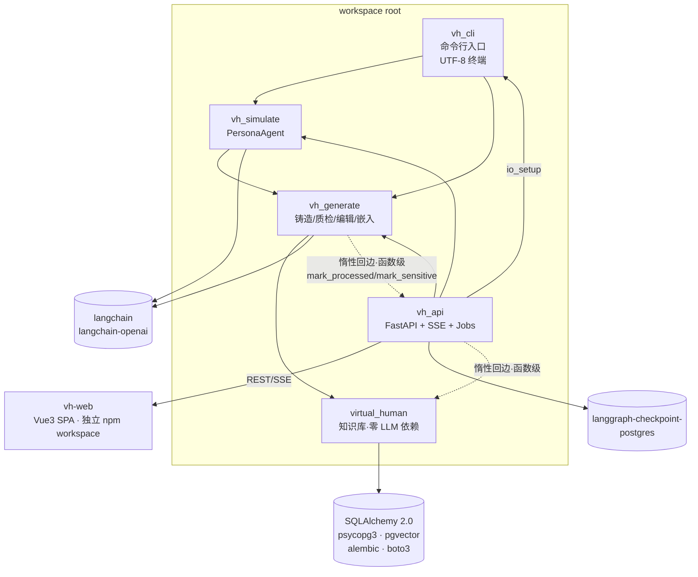
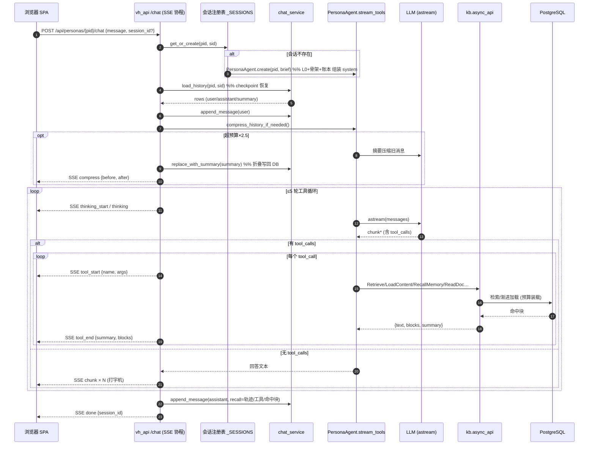
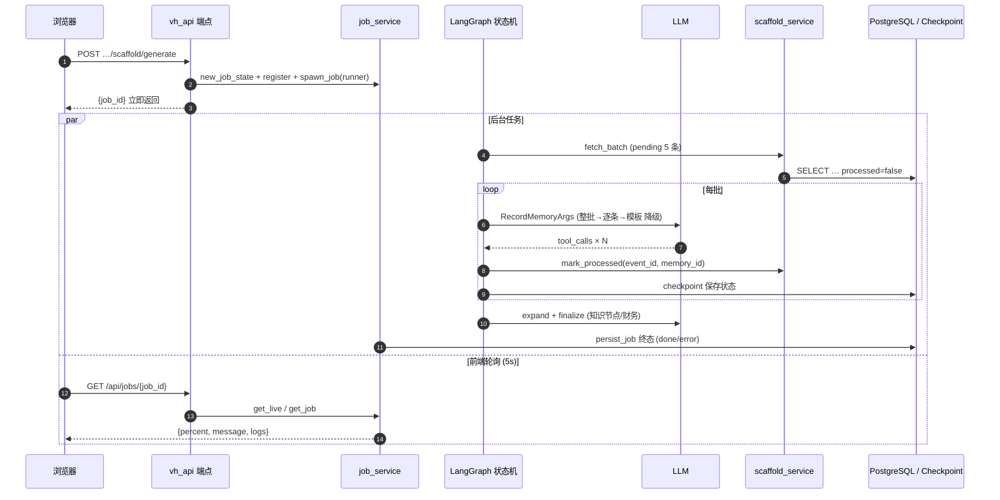
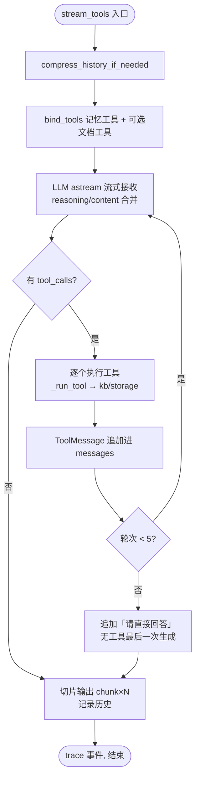

# 架构五视图（4+1 视图模型）

> 依据 Kruchten 4+1 视图模型，从五个视角描述「模拟人类」虚拟人系统。
> **场景视图是核心**：它驱动并验证其余四个视图；其余四视图各自面向不同干系人。
> 所有图例与结论均来自源码事实（标注文件/函数），与《整体架构》《核心技术实现》互为补充。

| 视图 | 面向 | 关注点 | 视角 | 表达方式 |
| --- | --- | --- | --- | --- |
| 场景视图 | 全体干系人 | 功能需求的具体用例 | 动态 | 用例图 + 场景走查 |
| 逻辑视图 | 用户 / 设计人员 | 功能需求、对象模型及关系 | 静态 | 类图、对象图 |
| 开发视图 | 程序员 | 模块组织、源码结构、可重用性 | 静态 | 包图、组件图 |
| 进程视图 | 系统集成人员 | 并发、同步、通信 | 动态 | 序列图、活动图 |
| 物理视图 | 系统工程人员 | 软硬件映射、部署、网络分布 | 静态 | 部署图 |

---

## 1. 场景视图（核心）

### 1.1 参与者

| 参与者 | 说明 |
| --- | --- |
| **数据工程师** | 准备人生履历 JSON，执行铸造，维护知识库 |
| **质检员** | 审查人物数据质量，处理质检问题，人工修订骨架/性格 |
| **访谈者** | 与虚拟人对话，观察记忆回忆与性格表现 |
| **外部系统** | 履历数据源（问卷/档案抽取的 JSON）、LLM 服务商 |
| **运维** | 启动服务、观察自检与健康状态 |

### 1.2 用例图

```mermaid
graph LR
    actor DE as 数据工程师
    actor QC as 质检员
    actor IV as 访谈者
    actor EXT as 外部系统(履历源)
    actor OPS as 运维

    subgraph 血肉铸造台 Forge
        UC1((创建人物并<br/>导入骨架事件))
        UC2((渐进式铸造<br/>记忆/知识/财务))
        UC3((增删改履历<br/>insert/replace/merge))
        UC4((重新生成骨架<br/>/性格/展开))
        UC5((查看铸造任务<br/>进度与日志))
    end

    subgraph 人物质检室 Inspect
        UC6((浏览知识树<br/>/图谱/时间线))
        UC7((质检人物数据))
        UC8((自动修复问题))
        UC9((一句话编辑修改))
        UC10((人工修订骨架<br/>与性格导向))
    end

    subgraph 人物模拟厅 Simulate
        UC11((流式对话<br/>渐进回忆))
        UC12((会话恢复<br/>/清空))
        UC13((管理 agent<br/>知识文档))
    end

    subgraph 系统
        UC14((自检与健康<br/>状态查询))
        UC15((CLI 离线操作<br/>ingest/show/chat))
    end

    DE --> UC1 & UC2 & UC3 & UC4 & UC5
    QC --> UC6 & UC7 & UC8 & UC9 & UC10
    IV --> UC11 & UC12 & UC13
    EXT -- 履历 JSON --> UC1
    OPS --> UC14
    DE --> UC15
```

### 1.3 用例—视图追踪矩阵（场景驱动四视图）

| # | 用例 | 逻辑视图承载类 | 开发视图承载模块 | 进程视图承载过程 | 物理视图承载节点 |
| --- | --- | --- | --- | --- | --- |
| UC1 | 导入骨架 | LifeScaffoldEvent / `_new_event` | vh_api.scaffold_service | save_events 协程 | API 节点 ↔ PG |
| UC2 | 渐进铸造 | ScaffoldHandlers / RecordMemoryArgs / RangeFeed | vh_generate(…/scaffold_gen, scaffold_graph) | LangGraph 状态机 + 后台 Task | API/LLM/PG/checkpoint |
| UC3 | 增删改 | apply_events / drop_event | vh_api.scaffold_service | 事务 + 再生成 job | API ↔ PG |
| UC7 | 质检 | QcIssue / check_persona_async | vh_generate.checker | 后台 Task + 轮询 | API/LLM/PG |
| UC11 | 流式对话 | PersonaAgent / 五个回忆工具 | vh_simulate.simulate | SSE 协程 + 工具循环 | API/LLM/PG/RustFS |
| UC12 | 会话恢复 | ChatMessage / chat_service | vh_api.chat_service | checkpoint 恢复序列 | API ↔ PG |
| UC13 | 文档管理 | DocMeta / storage / 文档工具 | virtual_human.storage + docs_middleware | to_thread 并发 | API ↔ RustFS |
| UC14 | 自检 | HealthCheck 协议 + 6 项实现 | virtual_human.healthcheck | asyncio.gather 并发自检 | 全部节点 |

### 1.4 核心场景走查：UC2 渐进铸造（贯穿全系统的样板）

```
1. 数据工程师在锻造页粘贴履历 JSON, 点「导入并铸造」
2. POST /api/personas/scaffold        → 建 Persona + save_events (UC1)
3. POST …/scaffold/generate           → 立即返回 job_id, 后台 Task 启动
4. 状态机: ensure_skeleton → ensure_personality → fetch_batch ⇄ generate_memories
   每条事件: LLM 调 RecordMemoryArgs → EpisodicMemory + 展开内容 + mark_processed
   被审核拦截: 整批 → 逐条 → 模板兜底 + sensitive 黄标
5. expand_events → finalize(知识节点≤12 + 财务按候选编号入账 + bio_skeleton 索引回写)
6. 前端每 5s 轮询 GET /api/jobs/{id}: percent / logs / message
7. 完成 → 跳转人物列表, 进入模拟厅对话 (UC11) 验证人物"活没活"
```

验证要点（场景对四视图的约束）：第 4 步中断后重启能续跑（进程视图 checkpointer）；第 5 步金额不编造（逻辑视图候选编号协议）；第 6 步轮询不阻塞其它请求（进程视图 asyncio 并发）。

---

## 2. 逻辑视图

面向功能需求的对象模型。分三组：**领域对象**（持久化实体）、**服务对象**（用例编排）、**接口对象**（协议与注入点）。

### 2.1 知识域类图



### 2.2 骨架/运行域类图



### 2.3 服务与接口对象



**关键设计关系**：
- **协议优于继承**：HealthCheck 是 `typing.Protocol`，六个实现分布在不同包，靠 `register_check()` 注册聚合——逻辑视图的开放封闭点。
- **注入反转**：`register_embedder` 让知识库层（下层）能调用嵌入能力（上层能力），而代码依赖仍保持向下——逻辑依赖与物理依赖解耦。
- **工具即接口**：LLM 与系统的边界是 4 组 Pydantic 工具 schema + 5 个回忆工具 + 3 个文档工具，全部可校验、可枚举。

### 2.4 对象图（一个运行时快照示例）

人物 `chen-zhiqiang`（slug）的一次对话会话对象快照：

```mermaid
graph LR
    subgraph 进程内对象
        AG[PersonaAgent<br/>persona_id=6ad0f4ae…<br/>history=14 msgs] 
        SS[ChatSession<br/>thread_id=6ad0f4ae-a1b2c3…]
        CTX[RetrievedContext<br/>used=1820/4000 tokens<br/>blocks=5]
    end
    subgraph 持久化对象·PG
        P((Persona<br/>陈志强·live))
        N1((KbNode<br/>职业与工作<br/>importance=8))
        N2((KbNode<br/>家庭与婚姻<br/>importance=7))
        M1((EpisodicMemory<br/>《女儿出生那年冬天》<br/>occurred=1998-11))
        C1((KbNodeContent<br/>对金钱的态度<br/>seq=0))
        E1((KbEmbedding<br/>entity=memory:M1<br/>HNSW))
        F1((FinanceEvent<br/>购置房产<br/>180000 · 2010))
    end
    SS --> AG
    AG --> CTX
    CTX --> M1
    CTX --> C1
    N1 --- C1
    M1 --- E1
    F1 --> M1
    P --- N1 & N2 & M1 & F1
```

---

## 3. 开发视图

面向程序员：源代码如何组织成模块、依赖规则、可重用单元与开发环境。

### 3.1 包图（uv workspace，五包单向依赖）



实线 = pyproject 声明的模块级依赖（单向向下）。**虚线 = 函数级惰性 import**，用于打破循环：
- `vh_generate/generate/scaffold_gen.py` 内部 `from vh_api.scaffold_service import mark_processed / mark_sensitive`（仅出现在函数体内）；
- 状态机编排 `scaffold_graph.py` 则通过 `ScaffoldHandlers` 注入彻底避免回边（示范做法）。

> 约定：新增回边必须（a）函数级延迟导入，（b）只调用纯工具函数，不得反向触达业务编排。

### 3.2 组件图（运行组件与提供的接口）

```mermaid
graph LR
    subgraph vh_api 组件
        R1[«component» scaffold_service<br/>提供: save_events/apply_events/<br/>fetch_pending_batch/stats]
        R2[«component» job_service<br/>提供: spawn_job/persist_job/<br/>list_jobs]
        R3[«component» chat_service<br/>提供: load_history/append_message/<br/>replace_with_summary]
        R4[«component» checkpointer<br/>提供: async_checkpointer/<br/>make_thread_id]
        R5[«component» infra<br/>提供: SseChannel/<br/>SessionRegistry]
        R6[«component» application<br/>提供: persona_service]
    end
    subgraph vh_generate 组件
        G1[«component» scaffold_gen<br/>五步铸造流水线]
        G2[«component» scaffold_graph<br/>LangGraph 状态机]
        G3[«component» progressive<br/>RangeFeed/折叠/降级]
        G4[«component» compression<br/>compress_messages]
        G5[«component» seeder_tools/checker/editor]
        G6[«component» embeddings<br/>register()]
    end
    subgraph vh_simulate 组件
        S1[«component» simulate<br/>PersonaAgent]
        S2[«component» docs_middleware<br/>文档工具]
    end
    subgraph virtual_human 组件
        V1[«component» models/scaffold/chat/qc/jobs<br/>ORM]
        V2[«component» kb.retrieval · kb.async_api<br/>渐进加载 API]
        V3[«component» db/config/storage/<br/>healthcheck]
    end

    R1 --> V1
    R2 --> V1
    R3 --> V1
    R4 --> LG2[(langgraph PG saver)]
    G1 --> G3 & G4 & G6
    G1 -.-> R1
    G2 --> G1
    S1 --> V2 & G5
    S2 --> V3
    V2 --> V1
    G6 -.->|注册嵌入| V2
```

### 3.3 目录结构（源码事实）

```
virtual_human/                     ← uv workspace 根
├─ src/
│  ├─ virtual_human/              ← 知识库层（无 LLM 依赖）
│  │  ├─ models.py scaffold.py chat.py qc.py jobs.py   ORM 唯一事实来源
│  │  ├─ kb/{retrieval.py, async_api.py}               渐进加载 双引擎 API
│  │  ├─ db.py config.py storage.py healthcheck.py checks.py
│  ├─ vh_generate/generate/       ← 生成层
│  │  ├─ agent.py seeder_tools.py scaffold_gen.py scaffold_graph.py
│  │  ├─ progressive.py compression.py checker.py editor.py
│  │  └─ embeddings.py tools.py seeder.py
│  ├─ vh_simulate/                ← 模拟层
│  │  ├─ simulate.py              PersonaAgent
│  │  └─ docs_middleware.py       文档工具中间件
│  ├─ vh_api/                     ← 服务层
│  │  ├─ main.py                  FastAPI 全部端点
│  │  ├─ scaffold_service.py job_service.py chat_service.py checkpointer.py
│  │  ├─ application/ infra/ routers/(预留)
│  └─ vh_cli/                     ← CLI 层
├─ web/src/views/                 ← 9 视图 SPA（独立 pnpm workspace）
├─ migrations/ sql/ scripts/ docs/ tests/
└─ pyproject.toml uv.lock alembic.ini
```

### 3.4 可重用性设计

| 可复用单元 | 复用方式 |
| --- | --- |
| `virtual_human.kb` | 任何消费者（CLI/API/Agent 工具）共用同一套渐进加载 API；同步/异步双实现一一对应 |
| Pydantic 工具 schema | 同一 schema 同时用于 LLM bind_tools、参数校验、SSE 轨迹瘦身（`_brief_args`） |
| `on_log/on_chunk` 回调约定 | 所有长任务共用，天然适配 CLI 打印 / job 日志 / SSE 三种前端 |
| `RangeFeed` | 履历、记忆两类大列表复用同一分页-折叠-降级机制 |
| `SseChannel` | 回调风格 API → 异步流的通用桥（生成类端点复用） |
| ORM 约定 | uuid36 主键、JSONB variant 降级、CASCADE 清理，全表一致 |

### 3.5 开发环境与构建

```
uv sync                          # 一键安装五包 (workspace source 联动)
uv run vh-api [--port 8300]      # API 服务 (uvicorn, lifespan 自检)
uv run vh-ingest / vh-show / vh-chat
cd web && pnpm dev               # vite :5173 代理 API
uv run alembic upgrade head      # 迁移
pytest                           # tests/
```

- Windows 硬约束：`main.py` 模块头部与 `db.run_async` 统一切 `WindowsSelectorEventLoopPolicy`；uvicorn 显式 `loop="asyncio"` 并自建循环。
- 配置全部经 `pydantic-settings`（`.env`），代码零 `os.environ`。

---

## 4. 进程视图

面向运行时：进程/任务结构、并发与同步、通信机制。

### 4.1 进程与任务结构

**单一服务进程**（`uv run vh-api`）承载全部并发，无多进程/多机分布式：

```
vh-api 进程 (Windows: SelectorEventLoop / 单事件循环)
├─ uvicorn 请求处理协程 ×N          ← REST + SSE 长连接 (timeout_graceful_shutdown=3s)
├─ SSE 生成器协程 ×N               ← /chat: 边流式输出边驱动用例
├─ 后台任务 asyncio.Task ×N        ← job_service.spawn_job 登记 (_TASKS 集合)
│    ├─ ingest / scaffold / expand / skeleton / personality
│    └─ check / fix / edit        (_CHECK/_FIX/_EDIT_TASKS 进程内状态 dict)
├─ LangGraph 状态机协程            ← scaffold-generate job 内 astream(updates)
├─ SQLAlchemy async engine 连接池  ← psycopg3 async (pool_pre_ping)
├─ AsyncConnectionPool(max_size=5) ← langgraph checkpoint 专用
└─ boto3 client (线程池)           ← asyncio.to_thread 包装, threading.Lock 单例
```

**并发与同步机制**：

| 机制 | 位置 | 目的 |
| --- | --- | --- |
| asyncio 单线程事件循环 | 全局 | 进程内 dict（_SESSIONS/_LIVE/_TASKS）免锁访问 |
| `asyncio.create_task` + done_callback | job_service.spawn_job | 后台任务登记/退出摘除；shutdown 统一 cancel |
| `asyncio.Queue` | infra/sse.SseChannel | 同步回调(on_log/on_chunk) → 异步流 的桥接 |
| `asyncio.gather` + wait_for(5s) | healthcheck.run_checks | 六项自检并发、单项限时 |
| `threading.Lock` | storage._s3 | boto3 client 进程内单例 |
| `asyncio.to_thread` | storage / 异步嵌入 | 阻塞 IO 移出事件循环 |
| PG 行级事务 | apply_events / drop_event | 级联删除原子性 |
| processed 游标 | life_scaffold_events | 任务级幂等/断点续跑 |

### 4.2 序列图①：模拟对话（SSE + 渐进回忆工具循环）



### 4.3 序列图②：后台铸造任务（job 模式）



### 4.4 活动图：对话工具循环（stream_tools 内部）



### 4.5 通信方式汇总

| 通道 | 协议/形式 | 方向 |
| --- | --- | --- |
| 浏览器 ↔ vh_api | HTTP REST (JSON) + SSE (text/event-stream) | 请求/事件流 |
| 前端轮询 | GET /api/jobs/{id}、/check|fix|edit/status | 5s/2s 周期 |
| vh_api ↔ LLM | HTTPS，OpenAI 兼容流式 (astream) | 双向流 |
| 进程内 | 回调 on_log/on_chunk → asyncio.Queue → SSE 帧 | 桥接 |
| ↔ PG | psycopg3 async 连接池；checkpoint 独立池 | 查询/事务 |
| ↔ RustFS | boto3 (S3v4 path-style)，to_thread | 对象读写 |

---

## 5. 物理视图

面向系统工程人员：软件制品到硬件/网络节点的映射。

### 5.1 部署图

```mermaid
flowchart TB
    subgraph CLIENT[客户端设备]
        BR[«artifact» vh-web SPA<br/>dist 静态资源<br/>Vite dev :5173 / 静态托管]
    end

    subgraph APPNODE[应用服务器 · Windows / 单机]
        UV[«artifact» vh-api 进程<br/>uvicorn :8300 (loop=asyncio)<br/>含全部业务包 + 后台任务]
    end

    subgraph DBNODE[数据库服务器 (可与应用同机)]
        PG[«node» PostgreSQL :55432<br/>pgvector · HNSW<br/>业务表 + jobs + chat_messages<br/>+ langgraph checkpoint 表]
    end

    subgraph OBJNODE[对象存储节点 (podman 容器, 可选)]
        RF[«node» RustFS<br/>S3 :9000 / 控制台 :9001<br/>bucket vh-docs]
    end

    subgraph EXT[外部服务]
        LLM[「node」 LLM API<br/>OpenAI 兼容 HTTPS<br/>VH_LLM_MODEL / VH_EMBED_MODEL]
        GIT[「node」 GitHub<br/>virtual_human_soul.git]
    end

    BR -- "HTTP REST / SSE<br/>(CORS allow *)" --> UV
    UV -- "psycopg3 async<br/>(池化)" --> PG
    UV -- "S3 API (boto3<br/>path-style)" --> RF
    UV -- "HTTPS 流式" --> LLM
    GIT -.->|ci/pull 部署制品| APPNODE
```

### 5.2 制品—节点映射

| 制品 (artifact) | 部署节点 | 说明 |
| --- | --- | --- |
| `vh-api` (uv console-script) | 应用服务器 | 单进程承载 REST/SSE/后台任务；`--reload` 开发热重载 |
| `vh_cli` 三个命令 | 开发机 | 离线运维/演示路径，不经 HTTP |
| `web/dist` | 静态托管或 vite dev | **后端未挂 StaticFiles**，SPA 为独立部署单元 |
| `alembic migrations` | 应用服务器 → PG | `upgrade head`；checkpoint 表由 `saver.setup()` 幂等自建 |
| `.env` | 应用服务器 | PG/LLM/RustFS 全部连接配置 |

### 5.3 网络与端口清单

| 端口 | 服务 | 用途 |
| --- | --- | --- |
| :8300 | vh-api | REST API、SSE、/docs |
| :5173 | vite dev | 前端开发（代理 API） |
| :55432 | PostgreSQL | 业务数据 + 向量 + checkpoint |
| :9000 / :9001 | RustFS | S3 端点 / 管理控制台 |
| :443 | LLM API | 模型与嵌入调用 |

### 5.4 物理层弹性说明

- **单机最小部署**：APP+DB+RustFS 同机即可跑通全部场景（默认 55432 端口即本机容器）。
- **可拆分点**：DB 与 RustFS 均为独立网络节点，改 `.env` 即迁移；LLM 通过 base_url 可切任意兼容端点（含国产模型）。
- **优雅停机**：`timeout_graceful_shutdown=3` 截断 SSE → `cancel_running_jobs()` 取消后台任务 → `dispose_async_engine()` 释放连接池（进程视图的关闭序在物理层保证无悬挂 worker）。
- **故障恢复**：铸造任务崩溃后凭 PG checkpoint + processed 游标续跑；对话历史在 chat_messages，重启可续聊——物理节点重启不丢业务状态。

---

## 6. 五视图总览映射

```
                    ┌──────────────────────────────┐
                    │   场景视图 (核心, 15 个用例)    │
                    │  UC2 渐进铸造 · UC11 流式对话   │
                    └──────┬───────┬───────┬───────┘
             驱动/验证 ↓       ↓       ↓       ↓
   ┌──────────────┐ ┌────────────┐ ┌────────────┐ ┌────────────┐
   │ 逻辑视图      │ │ 开发视图    │ │ 进程视图    │ │ 物理视图    │
   │ 领域类×14     │ │ 五包单向    │ │ 单进程多协程 │ │ 5 类节点    │
   │ 服务类/协议   │ │ +2 惰性回边 │ │ SSE×job×工具 │ │ REST/SSE/  │
   │ 工具即接口    │ │ 双 workspace│ │ 同步机制×8   │ │ S3/HTTPS   │
   └──────────────┘ └────────────┘ └────────────┘ └────────────┘
```

| 干系人 | 看哪个视图 | 关键问题与答案 |
| --- | --- | --- |
| 用户/设计 | 逻辑 | 系统有什么能力？→ 三大域 14 类 + 工具接口 |
| 程序员 | 开发 | 代码怎么组织？→ 五包单向 + 回边约定 + 复用单元 |
| 集成人员 | 进程 | 怎么并发/通信？→ 单循环多协程 + SSE/job 两类时序 |
| 系统工程 | 物理 | 部署在哪？→ 单机最小集 + 4 个可拆分点 |
| 全体 | 场景 | 端到端怎么走通？→ 1.4 样板走查 + 追踪矩阵 |
